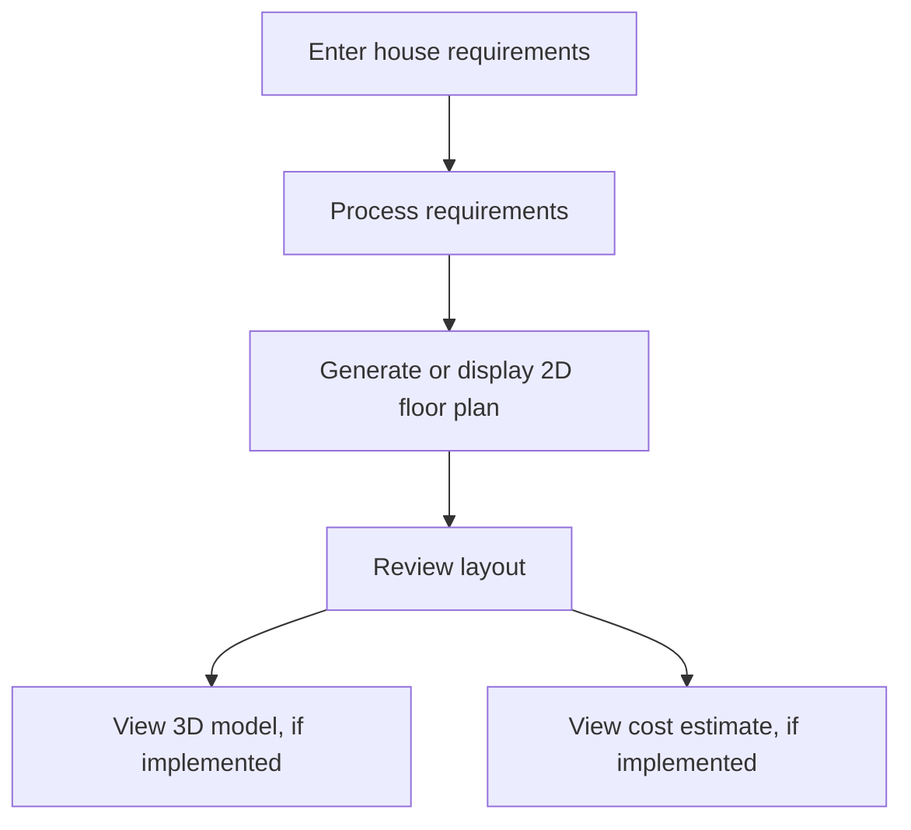

PlanForge – AI Floor Plan Generator & Construction Cost Estimator
From a Prompt to a Blueprint, From a Blueprint to a Budget.

PlanForge is a house-planning application designed to turn a user's housing requirements into a floor-planning workflow. It aims to bring together an editable 2D floor plan, a 3D house visualization, and a construction cost estimate in one place.

The project is intended to help homeowners, students, and small builders explore layout ideas and understand an initial construction budget before moving to professional planning.
Project note: This README describes the intended project workflow. Confirm each feature and technology against the current source code before publishing. Generated floor plans and cost estimates should be treated as preliminary planning aids, not as certified architectural drawings or contractor quotations.

Table of Contents
- Overview
- Problem Statement
- Objectives
- Features
- Typical Workflow
- Technology Stack
- Project Structure
- Getting Started
- Configuration
- How Cost Estimation Works
- Limitations
- Future Enhancements
- Testing Checklist
- Contributing
- License
Overview
Planning a house often involves multiple tools for collecting requirements, drawing layouts, visualizing the design, and estimating costs. PlanForge aims to simplify this early planning process through a single interface.

Users can describe the type of house they want, review a proposed layout, explore a 3D representation, and view an estimated construction budget where these features are implemented.
Problem Statement
Early-stage house planning can be difficult for people who do not have architectural design experience. Layout planning and cost estimation may require separate tools, and changes to requirements can make it harder to keep the design and budget aligned.

PlanForge aims to make initial design exploration more accessible by connecting house requirements, floor-plan visualization, and preliminary cost estimation in one workflow.
Objectives
- Make house requirements easier to enter and review.
- Help users explore room arrangements through a 2D floor plan.
- Provide a 3D view of the proposed design where supported.
- Present a preliminary construction cost breakdown.
- Keep the planning workflow simple and beginner-friendly.
- Clearly communicate assumptions and limitations.
Features
The following are project goals. Mark a feature as implemented only after verifying it in the current application.
- House requirement input: Enter details such as plot size, number of floors, bedrooms, and preferred style.
- Voice input: Enter requirements by speech if microphone access and speech recognition are supported by the current build.
- 2D floor plan: View and, if supported, edit a room layout with labels and dimensions.
- 3D visualization: Explore a three-dimensional representation of the design if the 3D viewer is implemented.
- Construction cost estimator: View an approximate material-wise or category-wise estimate if supported by the cost engine.
- Project management: Save, reopen, or manage designs if persistence and project-management features are implemented.
- Guide or help section: Learn how to provide requirements and interpret the output if this section is available.
Typical Workflow
1. The user enters house requirements.
2. The application processes the requirements using the logic and integrations implemented in the project.
3. A 2D layout is generated or displayed.
4. The user reviews the layout and makes available edits.
5. A 3D representation is displayed if supported.
6. The application calculates or displays a preliminary cost estimate if supported.

Technology Stack
The exact stack must be confirmed from the project's source files and dependency configuration.
Area	Technology
Development environment	Google AI Studio Build mode
Frontend framework	Confirm from package.json and source files
Language	Confirm from source files, for example JavaScript or TypeScript
Styling	Confirm from the project's CSS or styling dependencies
AI integration	Google Gemini API only if configured and used by the application
2D rendering	Confirm the library or rendering approach used
3D rendering	Confirm the actual 3D library, if any
Voice input	Web Speech API or another implementation, if present
Cost estimation	Confirm the actual calculation logic
Version control	Git/GitHub if used

Important: Do not list a library or service merely because it is mentioned in a plan. Verify it in the source code and dependency files first.
Project Structure
The structure below is illustrative. Replace it with the actual structure of the repository.
PlanForge/
├── public/                 # Static assets, if present
├── src/                    # Application source code, if present
│   ├── components/         # Reusable UI components, if present
│   ├── pages/              # Screens or routes, if present
│   ├── services/           # API or business logic, if present
│   └── styles/             # Stylesheets, if present
├── .env.example            # Example environment variables, if needed
├── package.json            # Dependencies and scripts, if using Node.js
├── metadata.json            # Build-mode metadata, if present
└── README.md
Use the real directory and file names from your project when finalizing this section.
Getting Started
Prerequisites
Install the tools required by the actual project. For a typical Node.js frontend project, this may include:
- Node.js (use the version supported by the project)
- npm, or the package manager indicated by the repository
- A modern browser
Run locally
The following commands apply only if the project contains a package.json with the corresponding scripts.
1. Clone the repository:
   git clone <YOUR_REPOSITORY_URL>
   cd <YOUR_PROJECT_DIRECTORY>
2. Install dependencies:
   npm install
3. Start the development server using the script defined in package.json. For example, if the project has a dev script:
   npm run dev
4. Open the local URL printed in the terminal.
If the repository uses a different package manager or command, follow the project's actual configuration instead. If you are using Google AI Studio Build mode, you can also run the app using the controls provided in that environment.
Configuration
Some builds may require environment variables, such as an AI API key. Check the source code to identify the exact variable names.

Example template only:
# Add only variables that the application actually reads.
# GEMINI_API_KEY=your_api_key_here
- Never commit real API keys or secrets to GitHub.
- Keep local environment files out of version control when they contain secrets.
- Provide a safe example file such as .env.example with placeholder values only.
- If an API key is required, configure it using the environment-variable or secret-management approach supported by the deployment platform. Do not expose private keys in client-side code.
How Cost Estimation Works
The estimate should be interpreted according to the implementation in the source code.

If the application uses fixed rates and formulas, describe it as a rule-based estimate. If it retrieves current rates from a verified external source, document that source and its update frequency. Do not describe the estimate as live market pricing unless the application actually retrieves live prices.

Construction costs can vary with location, labor rates, material quality, soil and foundation conditions, building regulations, design complexity, and contractor pricing. Users should verify estimates with qualified local professionals before making financial or construction decisions.
Limitations
Potential limitations to verify and document for the current build:
- Generated layouts may need review by a qualified architect or engineer.
- A visual 3D model does not necessarily include structural engineering or building-services design.
- Cost estimates may use simplified assumptions and may not reflect current local market prices.
- Voice input depends on browser support, microphone permissions, and the runtime environment.
- Saving projects across sessions requires an implemented persistence mechanism.
- The available editing controls and export formats depend on the features actually implemented.
Future Enhancements
Possible improvements include:
- More flexible room placement and dimension editing.
- Better synchronization between the 2D plan, 3D model, and cost estimate.
- Regional material and labor rate configuration.
- Project saving, version history, and sharing.
- Accessibility and multilingual improvements for voice and text input.
- Export options for suitable plan formats, if technically supported.
- Clear validation for plot dimensions, room sizes, and design constraints.
These are suggestions, not claims that the features are already available.
Testing Checklist
Before publishing a release, verify the following:
- [ ] The application starts using the documented command.
- [ ] Requirements can be entered and validated.
- [ ] The 2D floor plan displays correctly.
- [ ] Editing controls work as expected, if available.
- [ ] The 3D view opens and renders correctly, if implemented.
- [ ] The cost estimate is calculated and labelled with its assumptions.
- [ ] Voice input handles permission denial and unsupported browsers, if implemented.
- [ ] Navigation between tabs works.
- [ ] The interface remains usable on smaller screens.
- [ ] No API keys or secrets are included in the repository.
- [ ] README instructions match the actual project configuration.
Contributing
Contributions and suggestions are welcome.
1. Fork the repository.
2. Create a branch for your change.
3. Make and test your changes.
4. Submit a pull request with a clear description of the update.
Update this section if the project uses a different contribution process.
License
No license is specified here because the project's chosen license has not been confirmed. Add a license file, such as LICENSE, only after deciding which license applies to the project.
Credits
Project: PlanForge – AI Floor Plan Generator & Construction Cost Estimator
Tagline: From a Prompt to a Blueprint, From a Blueprint to a Budget.
Developer / Team: Add the appropriate name or
